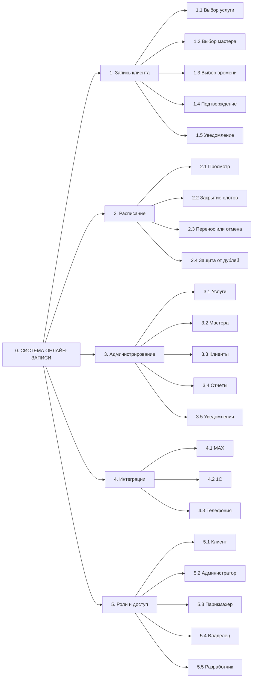
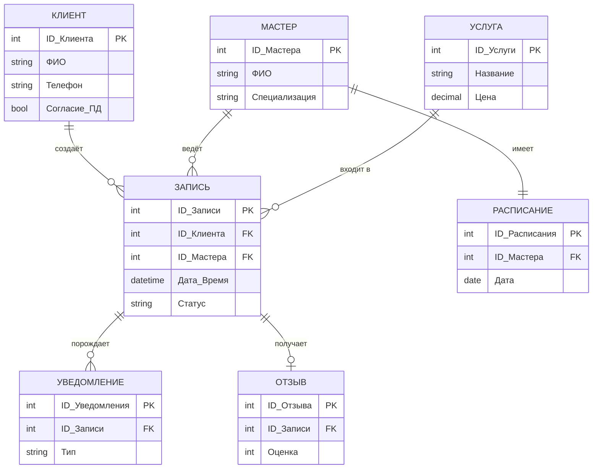
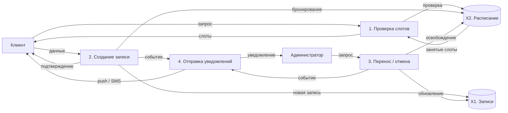
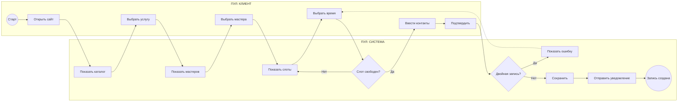
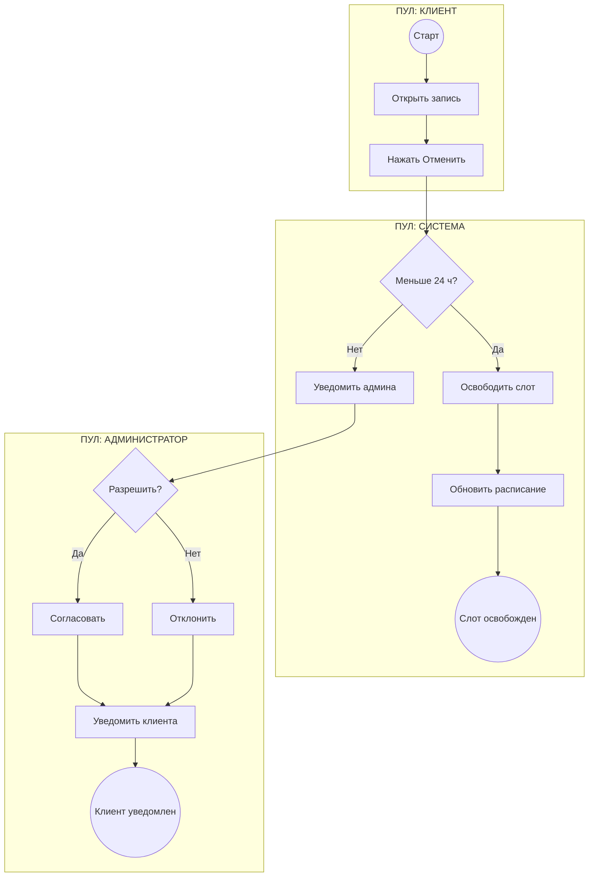
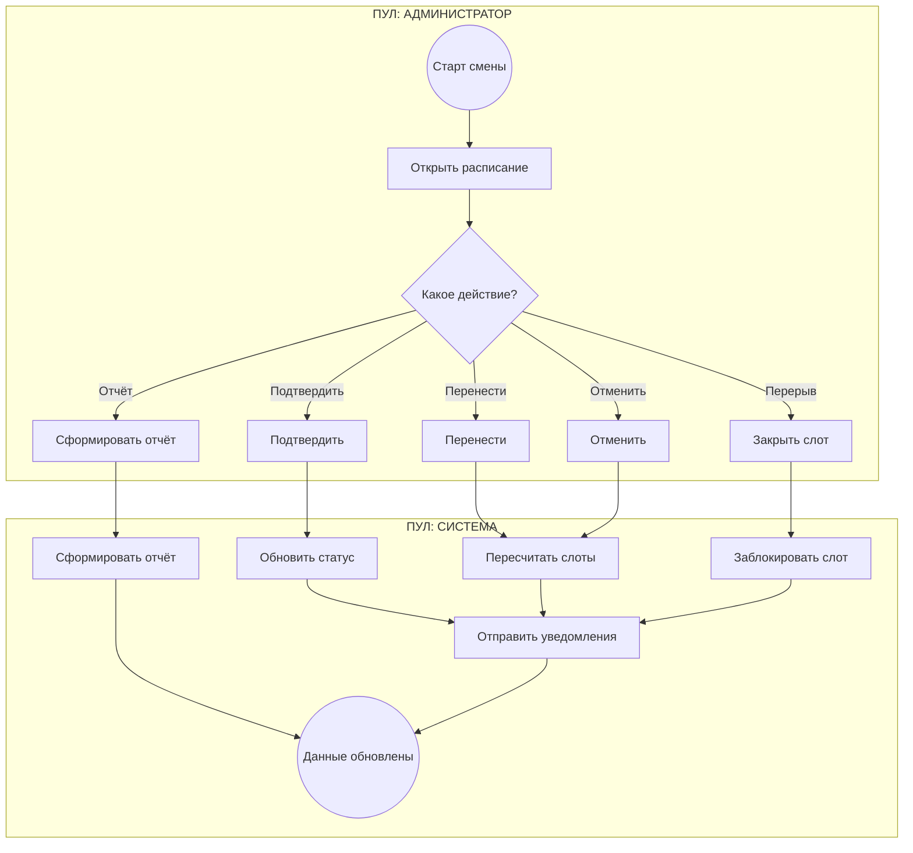
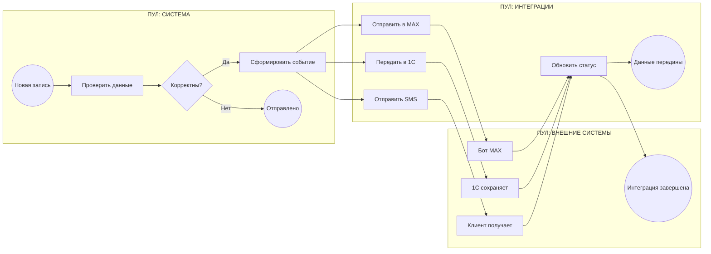

##  Концептуальная схема (Дерево функций)

##  ER-диаграмма (Модель данных)

##  DFD (Диаграмма потоков данных)

##  BPMN-схемы

### BPMN 1. Онлайн-запись клиента

### BPMN 2. Перенос или отмена записи

### BPMN 3. Управление расписанием администратором

### BPMN 4. Интеграции и уведомления

